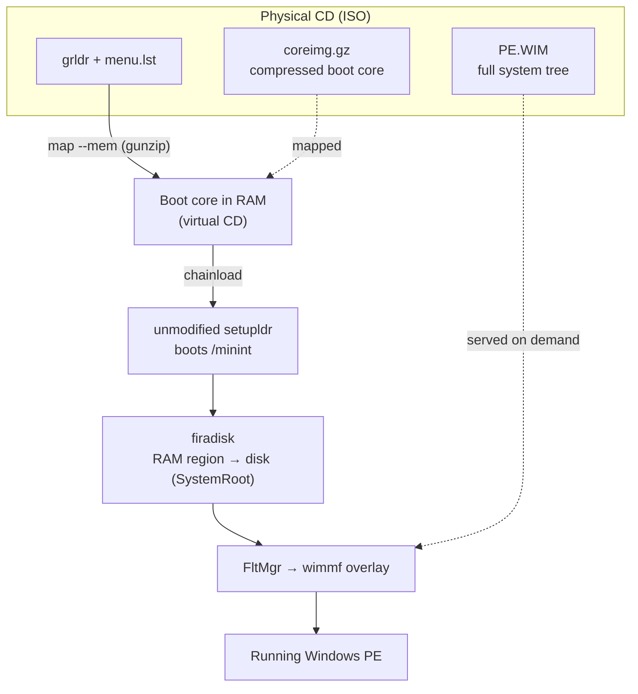

# Booting from a WIM (`layout = "wim"`)

By default a build masters the Windows file tree straight onto the ISO as loose files. The
`wim` layout instead packs the whole tree into a single compressed Windows Imaging (`.wim`)
image and boots the system out of it — the running OS reads its files on demand from the WIM on
the disc.

If you have used **Hiren's BootCD "Mini XP"**, this is the same idea: a small Windows that runs
from a WIM rather than from an installed disk, reading each file out of the image as it is
needed. What sets `wim` apart is *how* it does it:

- **Every component is open-source and clean-room.** The chain is an unmodified boot loader plus
  a filesystem overlay filter — nothing is binary-patched. Hiren's Mini XP boots through a
  hand-patched Windows loader with Microsoft's own image-format driver welded in; `wim` uses
  your source's loader unchanged and a separate, open-source filter driver to read the WIM.
- **You bring your own licensed Windows.** pe-builder ships no Microsoft files. It operates on
  the Windows installation media *you* supply and never redistributes any part of it — see
  [Bring your own Windows](../README.md#bring-your-own-windows).

> This is early, fast-moving work. The layout boots to the desktop on the verified sources in
> [`docs/supported.md`](supported.md), but details change between commits, and the plugins it
> needs are published separately (below).

## Why use it

- **A much smaller image.** The entire tree is LZX-compressed into one WIM, so the ISO is far
  smaller than the loose-file layout — a full themed desktop fits in tens of megabytes.
- **The Hiren's capability, fully open.** A live Windows that runs from a WIM is what tools like
  Hiren's Mini XP provide, but those lean on a patched Microsoft loader and Microsoft's own image
  driver. `wim` reaches the same result from an unmodified loader and an open-source filter,
  built from your own licensed Windows — no patched or redistributed Microsoft binaries anywhere
  in the chain.
- **Because a PE builder should be able to.** pe-builder is an independent, clean-room
  reconstruction of the PE-builder idea, built from scratch. A WIM-based boot chain — the modern
  way Windows itself boots a PE — is a natural part of that toolset, and implementing it in the
  open is its own reason.

## How it works



The boot proceeds in five stages, each handing off to the next:

1. **grub4dos** (`grldr`) reads `menu.lst` from the CD and maps a small boot-core image
   (`coreimg.gz`) into memory as a virtual CD (`map --mem`, which decompresses it on the way in).
2. It chainloads that RAM CD, and an **unmodified `setupldr`** — the Windows loader taken
   straight from your source — boots the minimal environment (`/minint`) off it.
3. **firadisk** reclaims the mapped memory region and re-presents it as a disk, so the system
   root resolves to the RAM CD once the kernel is up.
4. The **FltMgr** filter manager loads the **wimmf** overlay filter.
5. **wimmf** overlays the system tree with the contents of the full WIM (`PE.WIM`) on the
   physical CD, serving each file on demand as it is opened.

The split between the two images is deliberate. The **boot core** (`coreimg.gz`) holds only what
must exist *before* the overlay is serving — the loader, the kernel, the boot-start drivers, and
the registry the early boot needs. **Everything else lives in the WIM** and is read through
wimmf once it attaches. That is what keeps the boot core small and the whole payload in one
compressed file.

### If you know Linux live CDs

This is the same shape as a Linux live CD (the way Debian Live, Ubuntu's casper, or archiso
boot), with Windows parts in the roles:

| Linux live CD | `wim` layout |
|---|---|
| Bootloader loads the kernel and an **initrd** into RAM | grub4dos maps the **boot core** (`coreimg.gz`) into RAM |
| initrd carries *just enough* drivers to reach the real root | the boot core carries only the boot-start drivers and registry |
| Root filesystem is a compressed **squashfs**, read on demand | the payload is the compressed **`PE.WIM`**, read on demand |

As on a live CD, the image itself is read-only; the writable scratch and profile space comes from
a RAM disk, not from writing back to the WIM.

Two differences are worth naming, since the parallel isn't exact. Linux pivots onto the new root
and discards the initrd; Windows keeps the boot core and makes the rest of the tree *appear*
through a filesystem filter driver (wimmf) — closer to `overlayfs` than to `switch_root`. And that
filter is a read overlay, not a union mount: it serves files out of the read-only WIM but does not
copy writes back up, so writes land on the separate RAM disk rather than transparently across the
whole tree. If none of those names mean anything to you, ignore this section; the five steps above
are the whole story.

## What you need

- **A Windows installation source** you are licensed to use — a directory or ISO. See the
  verified sources in [`docs/supported.md`](supported.md).
- **An `iso` output target.** The `wim` layout requires it (there is no boot chain to master
  onto a loose directory).
- **Three out-of-tree plugins**, installed with `pebuild plugins add`. Each lives in its own
  repository, which publishes **prebuilt release archives** — so you can simply download the
  binaries instead of building them yourself, which would otherwise need the Windows Driver Kit
  for the kernel driver and each boot component's own toolchain:
  - **[`wimmf`](https://github.com/nradchenko/pe-wimmf)** (Apache-2.0) — the WIM overlay filter driver.
  - **[`firadisk`](https://github.com/nradchenko/pe-firadisk)** (GPL-3.0) — reclaims the RAM region as a disk.
  - **[`grub4dos`](https://github.com/nradchenko/grub4dos)** (GPL-2.0) — the loader that maps the boot core into RAM.

  The built-in **`wim-cd-boot`** plugin (bundled with pe-builder) wires these together and is
  enabled for you whenever `layout = "wim"` is set. If any of the three is missing, the build
  stops and names the one it needs.

## Building an image

Install the plugins once — download each release archive from its repository (linked above),
then add the local file:

```sh
pebuild plugins add wimmf.zip
pebuild plugins add firadisk.zip
pebuild plugins add grub4dos.zip
```

Then select the WIM layout in your manifest — this one line is all it takes; the boot chain
comes with it:

```hcl
layout = "wim"
```

See [`examples/wim.hcl`](../examples/wim.hcl) for a complete manifest — source, output, and a
themed desktop with games and utilities.

Build it, then boot the result in QEMU:

```sh
pebuild build manifest.hcl
pebuild run pe.iso
```

## What ends up on the media

A `wim` ISO carries, at its root:

- `grldr` and `menu.lst` — the grub4dos loader and its boot script.
- `coreimg.gz` — the compressed boot core mapped into RAM.
- `PE.WIM` — the full system tree, served on demand by wimmf.

Everything the running system needs is in `PE.WIM`; the rest is the machinery that gets the
kernel far enough to start reading it.

## See also

- [`docs/supported.md`](supported.md) — which Windows sources are verified, and what each
  produces.
- [`docs/inspecting.md`](inspecting.md) — inspecting a source or a built image with
  `pebuild` and `pewalk`.
